**Software Development Student · Technik Programista**

---

## About Me

I'm a software development student interested in building web, desktop and mobile applications.

- Currently studying Software Development.
- Interested in backend development and database systems.
- Building independent projects to gain practical experience.
- Constantly learning and exploring new technologies.

## Tech Stack

<!-- BEGIN ACTIVITY-GRAPH -->
<picture>
  <source media="(max-width: 767px)" srcset="activity-graph-mobile.svg">
  
</picture>
<!-- END ACTIVITY-GRAPH -->

## Projects

### [ChessAI_v2](https://github.com/Tidiest/ChessAI_v2)
Chess programming project exploring move generation, search algorithms and position evaluation.

`C++`

### [ProjektRazor](https://github.com/Tidiest/ProjektRazor)
HTML-based project.

`HTML`

---

*Building. Learning. Improving.*

